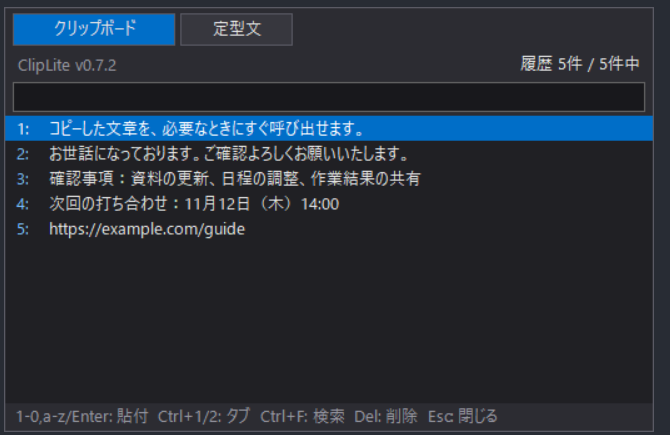
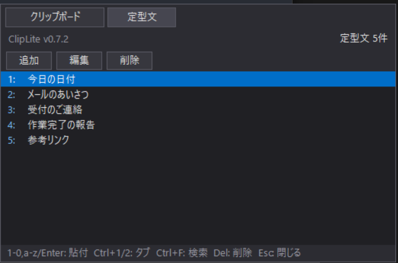
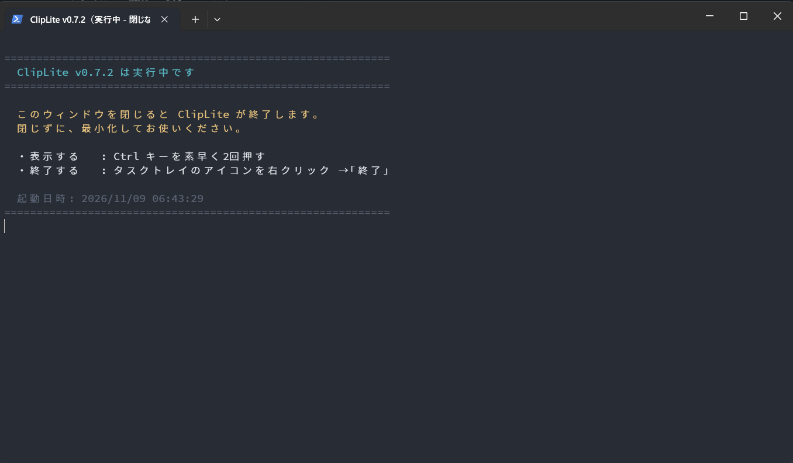

# ClipLite

Windows PowerShell 5.1とWindows標準.NET Frameworkで動作する、テキスト専用のクリップボード履歴・定型文ツールです。

Ctrlキー2回で表示し、数字・英字キーで項目を選択できます。履歴はメモリ内のみ、定型文はローカルJSONに保存します。

タイトル行の「配色」ボタンを押すと、システム → ライト → ダークの順に切り替わります。初回はWindowsのアプリの配色に従います。選択は次回の起動にも引き継がれます。

## 画面紹介

ClipLite v0.7.2の実画面です。履歴・定型文は撮影用のサンプルで、個人のクリップボード履歴ではありません。

### クリップボード履歴

コピーしたテキストを一覧から選択できます。`Ctrl+F`で検索し、先頭の数字・英字キーやEnterで選択した項目を貼り付けます。



### 定型文

よく使う文章を登録し、追加・編集・削除できます。本文に `{{DATE}}` を入れると、使用時に今日の日付へ置き換わります。



画像の原本とブログ向けの説明文は [掲載用画像ガイド](docs/SCREENSHOTS.md) にまとめています。

## 起動

リポジトリ直下の `Start-ClipLite.cmd` を実行します。初回起動時は `*.example.json` から個人用の `config.json` と `templates.json` を作成します。既存ファイルは上書きしません。

PowerShellとAdd-Typeの使用が許可された環境が必要です。実行ポリシーを自動変更しません。職場では組織の利用規程に従ってください。起動できない場合は `Start-ClipLite-Diagnostic.cmd` で確認します。

### ターミナルが表示された場合

ClipLiteはWindows PowerShell上で動作します。起動方法やWindowsの環境によって、PowerShellのターミナル（コンソール）が表示されることがあります。表示された場合は、**閉じずに最小化して使用してください。ウィンドウを閉じるとClipLiteも終了します。**

通常起動の `Start-ClipLite.cmd` には非表示指定がありますが、起動時に一瞬表示されたり、環境によってウィンドウが残ったりする場合があります。`Start-ClipLite-Diagnostic.cmd` やPowerShellから直接起動した場合は、診断情報や実行中の案内が表示されます。終了するときはタスクトレイのメニューから「終了」を選びます。



## フォルダー構成

```text
.
├── ClipLite.ps1                  アプリ本体
├── Start-ClipLite.cmd            通常起動
├── Start-ClipLite-Diagnostic.cmd 診断用起動
├── execute.bat                   起動用の互換入口
├── config.example.json          共有する標準設定
├── templates.example.json       公開可能な定型文サンプル
├── docs/                        操作説明・公開評価・掲載用画像
├── scripts/                     配布ZIPの作成
├── tests/                       検証コード
└── dist/                        生成した配布物（Git対象外）
```

`config.json`、`templates.json`、`ui-state.json`、ログ、ショートカットは個人用ファイルとしてGitから除外します。プライベートリポジトリでも、パスワード・機密情報を登録しないでください。過去に追跡したファイルは `.gitignore` だけでは履歴から消えません。

## 検証と配布

実行が許可されたWindows PowerShell 5.1で実行します。

```powershell
.\tests\Verify-ClipLite.ps1
.\scripts\Build-Release.ps1
```

配布スクリプトは指定したソースとサンプルのみを使い、`dist/ClipLite-v0.7.4.zip` とSHA256チェックサムを生成します。個人用JSON・ログは取り込みません。ZIPは展開先で直接起動できる構成です。

詳細は [操作説明](docs/USAGE.txt) と [公開評価](docs/PUBLICATION-REVIEW.md) を参照してください。GUIと実アプリへの貼り付け検証、各利用環境での動作確認は別途必要です。

## ライセンス

[MIT License](LICENSE)で配布します。

## 更新履歴

v0.7.4（2026-11-13）：Ctrl+2で定型文タブに切り替えた直後の自動非表示を修正し、ウィンドウからの配色切り替えに対応しました。

v0.7.3（2026-11-10）：定型文の追加・編集画面をダーク配色・フラットなボタンに統一。入力エラーを画面内に表示し、MITライセンスを配布ZIPへ同梱しました。掲載画像はv0.7.2のものです。
